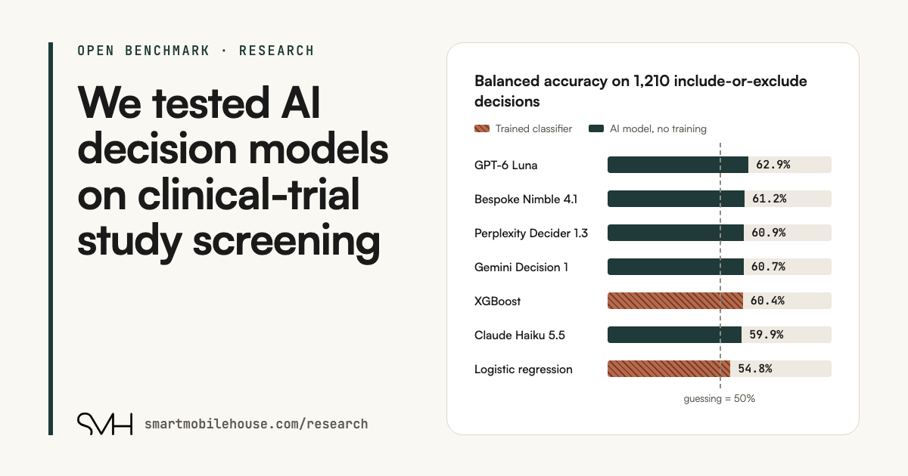

<p align="center">
  <picture>
    <source media="(prefers-color-scheme: dark)" srcset="assets/logo-dark.svg">
    
  </picture>
</p>
<h1 align="center">Clinical Trial Decision Lab</h1>
<p align="center">
  <strong>An open, reproducible benchmark of AI decision models against general LLMs and trained classifiers for clinical-trial evidence work.</strong><br>
  On 1,210 include-or-exclude decisions from 79 systematic reviews, six of seven systems scored 60–63%, where guessing scores 50%.
</p>

<div align="center">

[](LICENSE)
[](https://doi.org/10.5281/zenodo.24562228)
[](https://huggingface.co/datasets/smartmobilehouse/clinical-trial-decision-lab-screening)
[](https://smartmobilehouse.com)

</div>

<p align="center">
  <a href="https://smartmobilehouse.com/research/clinical-trial-decision-lab/"></a>
</p>

## Results

Report v1.0 (locked run of 25 November 2026). Full write-up with charts and ranges: [Where AI Decision Models Earn Their Place in Clinical-Trial Evidence Work, and Where They Do Not](https://smartmobilehouse.com/research/clinical-trial-decision-lab/).

**The task.** A systematic review considered a paper. Given the review's title and the paper's title and abstract, did the review include the paper or exclude it?

| System | Kind | Balanced accuracy (95% range) | Cost per 1,000 papers |
| :--- | :--- | :--- | :--- |
| GPT-6 Luna | General LLM, asked for a probability | 62.9% (60.0–65.9) | $0.0761 |
| Bespoke Nimble 4.1 | Decision model | 61.2% (58.2–64.1) | $0.0272 |
| Perplexity Decider 1.3 | Decision model | 60.9% (57.9–63.9) | $0.0134 |
| Google Gemini Decision 1 | Decision model | 60.7% (58.1–63.3) | $0.0649 |
| XGBoost | Trained on other reviews | 60.4% (57.7–63.2) | local |
| Claude Haiku 5.5 | General LLM, asked for a probability | 59.9% (56.9–62.9) | $0.1239 |
| Logistic regression | Trained on other reviews | 54.8% (52.3–57.3) | local |

- **The one pre-declared test passed, narrowly.** Decider 1.3 minus GPT-6 Luna was −2.01 points (range −4.96 to +0.80), inside the five-point margin fixed before the run. This does not show the two are equal.
- **Lower cost, repeatable answers.** Decider's estimated cost was 17.6% of GPT-6 Luna's. It repeated 99.3% of its include-or-exclude answers on a second pass.
- **No clear advantage over XGBoost.** Decider minus XGBoost was +0.48 points (range −3.17 to +4.27). It did beat logistic regression.
- **A cleaning error, found and rerun.** After the run we found that our text cleaning had deleted passages from 325 of the 1,210 abstracts. In a rerun with the passages restored, the outcome of every question was unchanged: Decider minus GPT-6 Luna was −0.80 points (range −3.64 to +2.02). The table above shows the locked run; the rerun is an after-the-fact check.
- **The two general LLMs changed some answers when asked again.** Sent the same frozen request twice within the hour, GPT-6 Luna changed 7.4% of its include-or-exclude answers and Claude Haiku 5.5 changed 4.5%, with reasoning off. The decision models changed 0 to 0.7%. Repeatable is not the same as right: all sit near 61%. This check was made after the fact, and it cannot say why the answers change.
- **Not reliable enough to act alone.** A rule that acted only on Decider's most confident answers was right on 65 of 91 automatic exclusions and 151 of 201 automatic inclusions.

The decision models and general LLMs had no training on this task; the classifiers learned from labelled papers from other reviews. The sample is balanced and uses open-licence abstracts only, so these are not figures for a real screening workload. See [Notes & limitations](#notes--limitations).

## What it compares

| System | How it answers | Runs |
|---|---|---|
| **Perplexity Decider 1.3**, **Bespoke Nimble 4.1** | Decision models: a probability for one yes-or-no question | Via API |
| **Google Gemini Decision 1** | Decision model | Via OpenRouter |
| **GPT-6 Luna**, **Claude Haiku 5.5** | General LLMs asked to return a probability, reasoning off | Via API |
| **XGBoost**, **logistic regression** | Classifiers on word features, trained on 5,067 labelled papers from 1,075 other reviews | Locally |

Every hosted model received the same review title, paper title, abstract and question through its own request format. The main measure is balanced accuracy, averaged equally over reviews, with ranges from 10,000 resamples of whole reviews. The sample, prompt, questions, pass marks and analysis script were fixed and fingerprinted before any prediction was collected.

## What is in this repository

| Part | Content | Model results |
|---|---|---|
| [`studies/screening/`](studies/screening/) | The study behind the report: plan, sample identifiers, runners, locked analysis, post-hoc checks, aggregate results | Yes, the table above |
| `src/triallab/`, `data/synthetic/` | The benchmark software, and an earlier synthetic benchmark for triage of enrollment-eligibility and informed-consent issues (600 fictional cases, eight frozen questions, a rules baseline) | Rules baseline only; no AI model has been run on it |

The two are separate. The report's results come only from the screening study.

The screening sample (identifiers and labels for the 1,210 papers, no abstracts) is also on Hugging Face, ready to load: [smartmobilehouse/clinical-trial-decision-lab-screening](https://huggingface.co/datasets/smartmobilehouse/clinical-trial-decision-lab-screening).

Not in this repository: paper abstracts (fetch them again from Europe PMC by identifier), the hosted models' per-paper answers (held back until each provider's terms on publishing raw outputs are confirmed; available on request, subject to each provider's terms), and any regulatory or patient-level material.

## Quick start

No API keys, no downloads beyond dependencies, no paid calls.

```bash
git clone https://github.com/SmartMobileHouse/clinical-trial-decision-lab
cd clinical-trial-decision-lab
uv sync --frozen          # install pinned dependencies (Python 3.12)
uv run triallab doctor    # check your setup; prints no secrets
```

Check the screening study offline (fingerprints of the frozen files, and the trained classifiers' scores recomputed from their saved predictions):

```bash
uv run pytest tests/unit/test_screening_study.py
```

See the benchmark software work in one command (offline):

```bash
make demo                 # rules on the synthetic test set, a dry run of two adapters -> outputs/demo-report.html
```

More commands:

```bash
uv run triallab models                                   # the model registry: enabled, verified, publishable
uv run triallab run --systems rules,flag_all,flag_none   # the local baseline on the synthetic test split
uv run triallab run --systems jev,llm_openai --dry-run   # exercise adapters with fixture responses
uv run triallab data verify                              # dataset reproducibility and label integrity
uv run triallab preflight --technical                    # automated publication checks
```

Re-running the screening analysis is described in [`studies/screening/README.md`](studies/screening/README.md).

## Configuration

Live runs read credentials from a local `.env` file (gitignored). Copy the template and fill in only the providers you want to run:

```bash
cp .env.example .env && chmod 600 .env
```

| Variable | Provider |
|---|---|
| `PERPLEXITY_API_KEY` | Perplexity Decider |
| `BESPOKE_API_KEY` | Bespoke Nimble |
| `OPENROUTER_API_KEY` | Google Gemini Decision 1 (through OpenRouter) |
| `OPENAI_API_KEY` | GPT-6 Luna |
| `ANTHROPIC_API_KEY` | Claude Haiku 5.5 |

The screening run requested `pplx-decider-v1.3`, `nimble-v4.1-max`, `google/gemini-decision-1`, `gpt-6-luna` and `claude-haiku-5-5`. A requested identifier does not freeze a provider's server implementation. All models, endpoints, prices and terms are in [`configs/models.yaml`](configs/models.yaml) and [`docs/MODEL-REGISTER.md`](docs/MODEL-REGISTER.md).

Live runs need `--allow-external-requests` and a `--max-cost-usd` estimate. The estimate is not a provider-enforced billing cap; use provider-side spending controls as well.

## Status

- [x] Screening study: locked run, independent recalculation, correction note, post-hoc checks, rerun with corrected text
- [x] Offline integrity test for the screening study
- [x] Adapters for decision models and structured-output LLMs, with a spending guard for live runs
- [x] Synthetic eligibility-and-consent benchmark: dataset, reference labels, rules baseline, metrics
- [x] Publication checks for data rights, provenance, restricted files and secrets
- [x] Hosted CI and a Zenodo archive of the code
- [ ] AI model runs on the synthetic benchmark
- [ ] Public release of the hosted models' per-paper answers

## Documentation

| Document | Content |
|---|---|
| [`studies/screening/README.md`](studies/screening/README.md) | The screening study: files, what is missing, how to re-run |
| [`studies/screening/reports/`](studies/screening/reports/) | The frozen plan, the original results, the correction note, the post-hoc checks |
| [`docs/BENCHMARK-SPECIFICATION.md`](docs/BENCHMARK-SPECIFICATION.md) | Synthetic benchmark: inputs, outputs, labels, reference rules, metrics, statistics |
| [`docs/ARCHITECTURE.md`](docs/ARCHITECTURE.md) | Packages, contracts, safety properties, adding a model |
| [`docs/REPRODUCIBILITY.md`](docs/REPRODUCIBILITY.md) | Exact commands, expected baseline values, limits of reproduction |
| [`docs/LIMITATIONS.md`](docs/LIMITATIONS.md) | What the synthetic benchmark cannot show |
| [`docs/MODEL-REGISTER.md`](docs/MODEL-REGISTER.md) | Every model: identifier, endpoint, price, terms, status |
| [`docs/DATA-LICENSING-AUDIT.md`](docs/DATA-LICENSING-AUDIT.md), [`docs/DATA-SOURCE-REGISTER.md`](docs/DATA-SOURCE-REGISTER.md) | Rights and register for every data source, tool and model API |
| [`docs/THIRD-PARTY-LICENSES.md`](docs/THIRD-PARTY-LICENSES.md), [`THIRD_PARTY_NOTICES.md`](THIRD_PARTY_NOTICES.md) | Dependencies and notices |
| [`docs/RELEASE-APPROVAL.md`](docs/RELEASE-APPROVAL.md) | Blockers and the release checklist |

## Development

```bash
uv sync --frozen
make check          # ruff, mypy, pytest (offline), dataset verification, licence screen, gitleaks, technical preflight
make format         # auto-fix lint and formatting
make release-check  # full publication preflight; fails until approvals are recorded
make help           # list all targets
```

Run `make check` before every push. Tests can never reach the network; tests that call a real paid API are marked `live` and never run by default. The files under `studies/` are byte-identical archived copies with frozen fingerprints, so the formatter skips them. See [`CONTRIBUTING.md`](CONTRIBUTING.md).

## Notes & limitations

- **Less information than a reviewer has.** The systems saw a review title, a paper title and an abstract. Reviewers decide with the full paper and written selection criteria. This is "predict the published decision from limited information", which is harder than, and different from, the reviewer's job.
- **Balanced, open-licence sample.** Half the papers were included and half excluded, and only abstracts under CC0, CC BY, CC BY-SA or CC BY-ND were used. Real workloads are not balanced.
- **A narrow pass on a chosen margin.** The five-point margin was set by judgement before the run. A four-point margin would not have been met. The claim concerns one named model with one prompt, not decision models in general.
- **Departures from the plan.** A cleaning error deleted passages from a quarter of the abstracts in the locked run (rerun with the passages restored: same outcomes); reports of the same trial were not linked as planned; two ranges were first computed with too few resamples; logs lack returned model identifiers for the general LLMs and caching details; the planned calibration analysis was not done. The effects are in the correction note in [`studies/screening/reports/`](studies/screening/reports/). No verdict changed.
- **Probabilities are not chances.** Four of the five hosted systems had a worse Brier score than always answering 50%.
- **Zero-shot against supervised.** The trained classifiers learned from labelled papers from other reviews; the hosted models saw each paper cold. That is deliberate.
- **Labels are published lists.** "Excluded" means the review listed the paper as assessed and rejected. The lists were not re-checked.
- **Independent checks were made by an AI model**, not by human reviewers.
- **Research only.** This is not a clinical tool or a regulatory tool, and it is not validated by clinical experts. No output is a recommendation about treatment, patient safety or the conduct of a review.
- **Costs are estimates** from token counts and a dated price snapshot, not invoices.
- **Providers change.** Models, prices and APIs move; every result is tied to its run date.
- **Provider terms.** Some providers' terms on publishing benchmark results are unclear. For Bespoke Labs we could find no published terms of service for its hosted service when we looked on 26 November 2026. Our reading of each provider's terms is in [`configs/models.yaml`](configs/models.yaml).
- **Data rights are yours.** MIT covers this project's code and its synthetic data only, never a third-party dataset, document or model output.
- This is an independent project and is not affiliated with or endorsed by Perplexity, Bespoke Labs, Google, OpenAI, Anthropic, OpenRouter, Cochrane, the TrialPanorama authors or any regulator.

## How to cite

If you use this benchmark or its results, please cite the report:

> Pietruszewski, J. (2026). *Clinical Trial Decision Lab: Where AI Decision Models Earn Their Place in Clinical-Trial Evidence Work, and Where They Do Not* (report version 1.0). Smart Mobile House. https://smartmobilehouse.com/research/clinical-trial-decision-lab/

The code is archived on Zenodo: [doi:10.5281/zenodo.24562228](https://doi.org/10.5281/zenodo.24562228) (all versions). GitHub's **Cite this repository** button gives APA and BibTeX.

```bibtex
@techreport{pietruszewski2026clinicaltrialdecisionlab,
  author      = {Pietruszewski, Jerzy},
  title       = {Clinical Trial Decision Lab: Where AI Decision Models Earn Their Place in Clinical-Trial Evidence Work, and Where They Do Not},
  institution = {Smart Mobile House},
  year        = {2026},
  type        = {Report},
  number      = {version 1.0},
  url         = {https://smartmobilehouse.com/research/clinical-trial-decision-lab/}
}

@software{pietruszewski2026clinicaltrialdecisionlab_code,
  author    = {Pietruszewski, Jerzy},
  title     = {Clinical Trial Decision Lab: a reproducible benchmark of AI decision models for clinical-trial evidence work},
  year      = {2026},
  publisher = {Zenodo},
  doi       = {10.5281/zenodo.24562228},
  url       = {https://github.com/SmartMobileHouse/clinical-trial-decision-lab}
}
```

## Contributing

Issues and pull requests are welcome; see [CONTRIBUTING.md](CONTRIBUTING.md). Report security issues as described in [SECURITY.md](SECURITY.md).

## Why Clinical Trial Decision Lab?

### Deciding which studies belong in a review is slow expert work

A systematic review gathers every trial on a clinical question. Choosing which studies to include is the step AI vendors most often promise to speed up.

### Vendor claims are hard to compare

- Decision-model APIs launched in 2026 are pitched as a cheap replacement for general LLMs wherever the answer is a decision.
- Published comparisons rarely use the same studies, the same information and a test fixed in advance, and few can be rerun.

### This lab measures them side by side

- The same papers, the same information and the same question for every hosted model.
- A plan, a sample and pass marks fixed and fingerprinted before the run, with departures reported.
- A trained baseline and a repeat pass, so accuracy, cost and repeatability are judged together.
- Offline by default; live calls are opt-in and cost-guarded.

It reuses the benchmark infrastructure of [Fraud Decision Lab](https://github.com/SmartMobileHouse/fraud-decision-lab).

## License

[MIT](LICENSE) © Smart Mobile House. Built and maintained by [Smart Mobile House](https://smartmobilehouse.com).

MIT covers this project's original software and original synthetic data. Third-party material keeps its own terms; see [`THIRD_PARTY_NOTICES.md`](THIRD_PARTY_NOTICES.md). The Smart Mobile House name is a trademark of Smart Mobile House and is not licensed under MIT. Generated reports remain subject to dataset, provider and other applicable rights; the code license does not grant publication permission.
